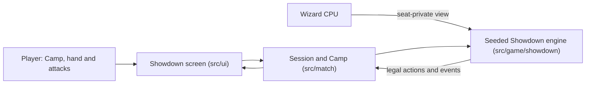

# Cowboys vs. Wizards

**A haunted-Western card duel: cowboys against wizards, where you choose every attack and your troops shield your Base.** It takes what long-running card games already proved (tribute summons, spells that answer a board, a graveyard, a deck you build) and keeps a duel short and easy to read.

## Play Showdown

[Open illustrated Showdown](https://alejandro-publius.github.io/cowboys-vs-wizards/). Choose **Ride or Fight?** to jump into a verified Outrider turn at The Bone Fence. You can attack a troop or ride past it to hit the Wizard Base. **Camp** opens the Trail, deck builder, Wanted bounties, and other modes. [Graybox](https://alejandro-publius.github.io/cowboys-vs-wizards/graybox/) runs the same rules with a lighter board, and the [reference page](https://alejandro-publius.github.io/cowboys-vs-wizards/showdown/) documents the full game.

Showdown is the supported game. The earlier three-lane duel is archived at `ea183ee29dbd`. The `/3d/` route serves illustrated Showdown and accepts the same direct duel links as the home page.

Open **Camp ledger → Sheriff’s Ledger** to replay one Billy duel at both 2 attack and the proposed 1 attack, starting from the same deal. In the [recorded Night Shift review](https://alejandro-publius.github.io/cowboys-vs-wizards/?saloon=review), you can inspect the rule and the result. Across 100,000 bot duels, the proposed change moved Cowboy wins from 59.792% to 51.920%. Billy still has 2 attack while the proposal awaits design approval. [Audit and recheck command](docs/evidence/billy-seat-audit/README.md)

The **Night Shift saloon** also holds the rules desk, the recorded Dusty Pete card trial, and a 54-decision replay from the Cautious Sheriff and Reckless Wizard agent match. Its back table opens [Boot Hill Poker](https://alejandro-publius.github.io/cowboys-vs-wizards/poker/), an optional experiment. [One-minute judge walkthrough](docs/JUDGE-GUIDE.md) · [Reproduce the Saloon findings](docs/evidence/night-shift-repair/README.md)

## Card art library

The [Showdown art direction catalog](prototypes/showdown/ART-DIRECTION.md) has prompts for all 29 cards, a shared style guide, 18 environment and prop briefs, and 13 model sheets. The [Sheriff](assets/cards/sheriff-card.webp) and [Dragon](assets/cards/dragon-card.webp) paintings are the style references.

Regenerate it after editing the briefs in [`prototypes/showdown/art.js`](prototypes/showdown/art.js):

```sh
node prototypes/showdown/export-art.mjs
```

The [Showdown card spreadsheet](prototypes/showdown/cards.csv) uses the same visual direction. Regenerate it with `node prototypes/showdown/export-cards.mjs`.

## Local build

Use Node.js 22.18 or later.

```sh
npm ci
npm run build
```

Open `dist/cowboys-vs-wizards-board-duel.html` in a desktop browser. **Play** opens the Showdown Camp. `?seed=N` fixes every deal started from the Camp, and `?practice=0` or `?practice=60` opens a fixed Boot Hill practice deal. Any old lane address (`?mode=lanes`, `match`, `ride-out`, `practice-*`, `fire-arc`) opens the same Showdown menu.

`npm run build -- --web` writes the same single file to `dist/web/index.html`, and `npm run build -- --hosted` writes the Pages copy there. `node prototypes/showdown/build.mjs` writes the full Showdown page to `dist/showdown.html`.

Run `node scripts/stage-pages.mjs --commit "$(git rev-parse HEAD)"` to stage the site in `dist/web/`. The same illustrated build serves `/` and `/3d/`. The other routes are `/graybox/` and `/showdown/`. Run `node scripts/check-pages-tree.mjs --browser` to check the tree and play the challenge over local HTTP.

Every Showdown card is in the [Showdown card spreadsheet](prototypes/showdown/cards.csv), and the rules are in the [rulebook](prototypes/showdown/RULEBOOK.md). `docs/cards.csv` and `docs/rules.csv` describe the retired lane duel and are kept as history.

## How it is made

Three tools share the work, and each is credited for what it did.

- **Fable (Claude Code)** leads the design: mechanics, progression and engine contracts. Its briefs are in [docs/design](docs/design/README.md).
- **Kiro** builds those briefs, integrates them and runs the checks. See [Built with Kiro](#built-with-kiro).
- **Codex** coordinates, reviews and verifies in the browser.

## Verify

Start with the normal Showdown Play path. Build once with `npm run build`; each browser check takes the built file.

| What you need | Command |
| --- | --- |
| Play opens the Camp; Boot Hill won with clicks; seat privacy; every retired lane address opens Showdown | `node scripts/browser-showdown-check.mjs dist/cowboys-vs-wizards-board-duel.html` |
| Camp modes: rivals, Wanted, packs, deck builder and side deck, best of three, two players, save code, Start over | `node scripts/browser-showdown-modes-check.mjs dist/cowboys-vs-wizards-board-duel.html` |
| Trail duels paid and kept after reload; lane keepsakes shown, not carried | `node scripts/browser-showdown-trail-check.mjs dist/cowboys-vs-wizards-board-duel.html` |
| Keyboard-only and mouse play | `node scripts/browser-showdown-keyboard-check.mjs dist/cowboys-vs-wizards-board-duel.html` |
| Combat cues | `node scripts/browser-showdown-cues-check.mjs dist/cowboys-vs-wizards-board-duel.html` |
| Showdown rules | `node --test prototypes/showdown/rules.test.js prototypes/showdown/contract.test.js tests/game/showdown-presenter.test.js` |
| Tests as run on every pull request | `npm test` |
| The staged Pages site, as CI checks it (add `--browser` for Chrome) | `node scripts/stage-pages.mjs --commit <sha>`, then `node scripts/check-pages-tree.mjs --commit <sha>` |
| Which commit the live site is (after a Pages deploy) | `curl https://alejandro-publius.github.io/cowboys-vs-wizards/build.json`; CI compares it and the live `index.html` digest, also at `/3d/`, with the built release ([evidence](docs/evidence/kiro-build-identity.md)) |

The saved **showdown-practice-replay** Workflow replays Boot Hill deals `?practice=0` and `?practice=60` in headless Chrome. Run `node scripts/verify-duel.mjs --browser` to test the staged Showdown site and its `/3d/` compatibility route. See the [Kiro write-up](docs/kiro-brag-sheet.md) for specs, hooks, tests, and replay evidence.

## Architecture at a glance

The Showdown engine decides which moves are legal and what damage happens; the screen shows those decisions. This keeps every seeded deal reproducible.



[Architecture and source ownership](docs/ARCHITECTURE.md) · [Current verified state and next priorities](docs/PROJECT-STATUS.md) · [Index of all documents](docs/README.md)

## Built with Kiro

Kiro's Requirements-First Orb Duel spec, custom agent, workspace steering, hooks, replay Workflow, and review Power/MCP are part of this repository—not a narrative added after the fact. The Orb Duel spec and its replay receipts record the retired lane build and stay as history. The Kiro work is distinguished from Fable's match rules/CPU and Codex's integration and verification.

[Follow the judge evidence trail](docs/JUDGE-GUIDE.md) · [Kiro usage and receipts](docs/kiro-brag-sheet.md) · [Actual build log](docs/kiro-build-log.md) · [Active closeout queue](docs/kiro-closeout-queue.md) · [Research/source register](docs/kiro-source-register.md)

### Night Shift balance run

Kiro CLI with Claude Opus 5.5 proposed each one-number change. A separate simulator measured each candidate with level-2 bots, with each deal played from both starting seats. The loop stopped on attempt 3 when both factions fell in the 45–55% band on both seed ranges. Billy’s change is a proposal for review.

| Attempt | Proposal | Cowboy wins, tuning | Cowboy wins, holdout | Gate |
| --- | --- | ---: | ---: | --- |
| 1 | Sheriff health 3 → 2 | 60.75% → 56.50% | 59.00% → 52.00% | Fail |
| 2 | Skeleton health 3 → 4 | 60.75% → 57.00% | 59.00% → 53.25% | Fail |
| 3 | Billy attack 2 → 1 | 60.75% → 50.25% | 59.00% → 51.00% | Pass |

[Recorded run and seeds](docs/evidence/kiro-contest-run.md) · [Native workflow screenshot](docs/evidence/kiro-night-shift-native.png) · [Observed Kiro usage](docs/KIRO_USAGE.md)

In a later native Kiro CLI workflow (`wf_3e26f2fcd93c25a1`) given no card choices, Kiro proposed six one-number edits, the reviewer rejected all six, and the six-attempt limit ended the loop with no live card changed. Attempt 4, Skeleton attack 1 → 2, met the 45–55% band on both seed sets (48.50% and 46.00% Cowboy wins), but the first player's tuning share rose from 58.75% to 60.00%, 1.25 points against the 1 allowed, so rule NSB-2 rejected it. Independently of those six, the fixed Billy attack 2 → 1 proposal from the original run passed on 25,000 fresh held-out seeds at 51.920% Cowboy wins (exit 0), against 59.792% for the current Billy (exit 2). [Six-attempt receipts, Billy audit and replay commands](docs/evidence/billy-seat-audit/README.md)

For ongoing balance review, the separate [Night Watch Kiro Crew app](https://github.com/alejandro-publius/cowboys-vs-wizards-night-watch) compares committed game revisions on matching CPU seeds, records changes and drafts issue reports. It is an optional local development tool, **not** part of the shipped browser game. [Crew run evidence](docs/evidence/kiro-night-watch.md).

## Code map

| Path | Owns |
| --- | --- |
| `src/game/showdown/` | Showdown rules, cards, screen contract, progress and save codes |
| `src/app.js` | Entry point: the Showdown title, Camp, deck builder and duel screens |
| `src/ui/showdown-*.js`, `src/ui/showdown.css` | Showdown screen, Camp, builder and cues |
| `src/match/showdown-*.js` | Showdown session, campaign and match flow |
| `prototypes/showdown/` | Rulebook, reference page, card spreadsheet and the [art direction](prototypes/showdown/ART-DIRECTION.md) |
| `.kiro/specs/duel-card-pipeline/cards/` | Card specs that the Showdown card table reads |
| `assets/` | Optimized Tripo models, card illustrations and media (source assets, kept) |
| `scripts/`, `tests/` | Build, replay, simulation and verification |
| `.kiro/`, `docs/` | Workspace guidance, requirements, research and evidence |

Legacy headless utilities still support archived rules experiments and reading old profile keepsakes. The playable lane build is in Git history at `ea183ee29dbd`.

Contributing with an AI agent? Start with [AGENTS.md](AGENTS.md), then use the [task-specific file router](docs/AGENT-ROUTER.md) rather than scanning the whole repository. Work on one owned area in a separate worktree and run its affected check. The engine decides outcomes. The screen renders the events and their before and after values.

## Assets and attribution

The models and clips in `assets/` are kept as source assets for the Showdown 3D layer. Dragon and Mounted Billy have articulated Blender attack clips. Skeleton has its fitted Tripo mesh. Sheriff has the approved sourced Mixamo idle. See the [animation plan](docs/character-animation-plan.md) before adding clips or replacing an export.

The pinned Lucca Cerf references and their MIT license are in [docs/references/lucca-character-factory](docs/references/lucca-character-factory). The [build log](docs/kiro-build-log.md) attributes work by Kiro, Fable, Codex, Tripo and the user.

[Verified closeout deployment](docs/evidence/kiro-closeout-deployment.md)
