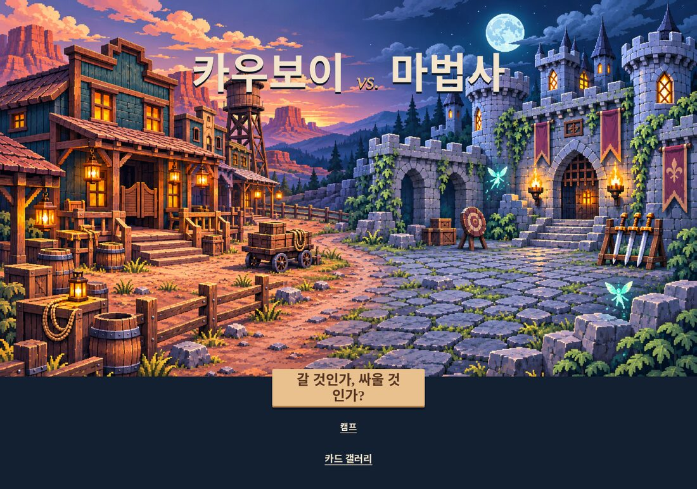
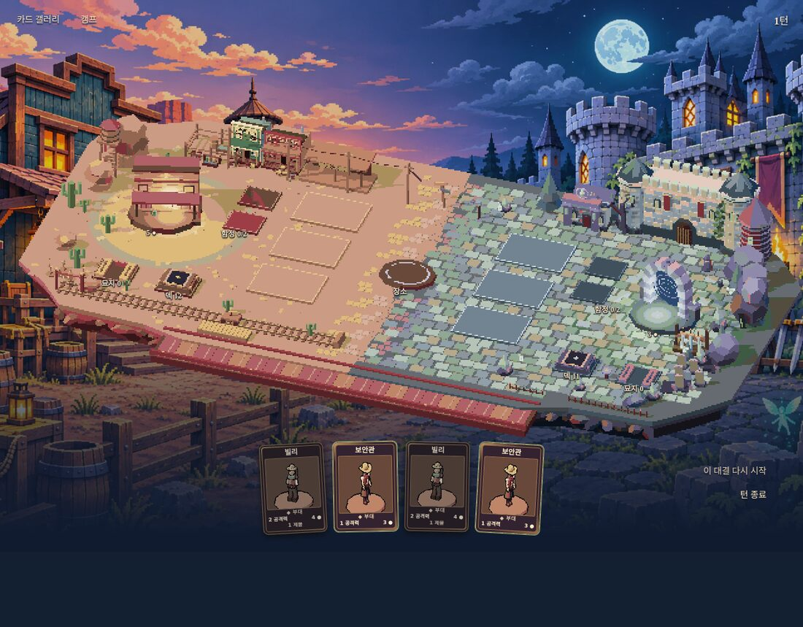
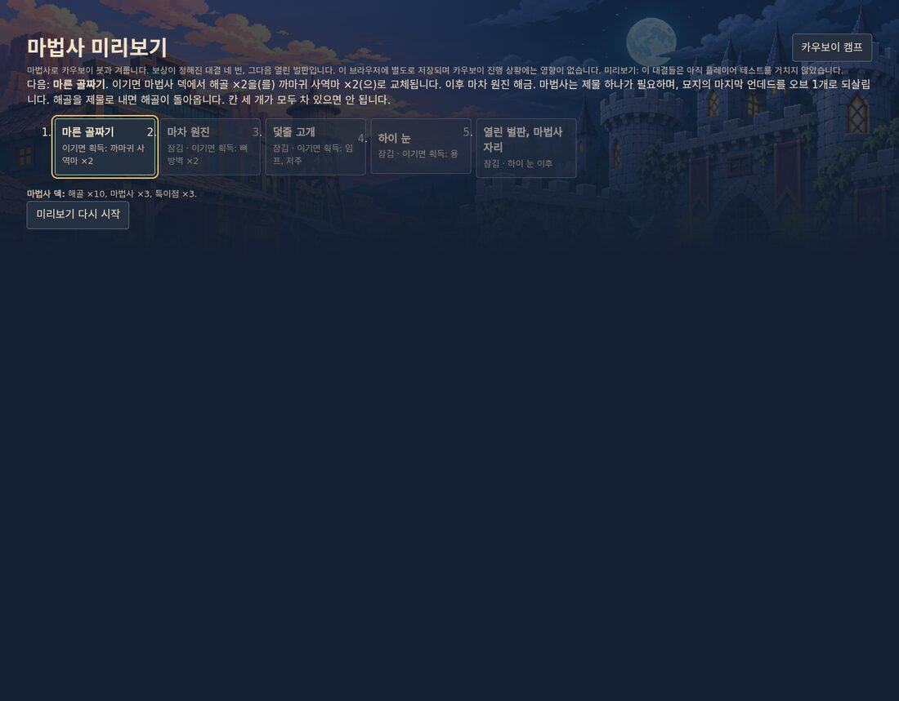
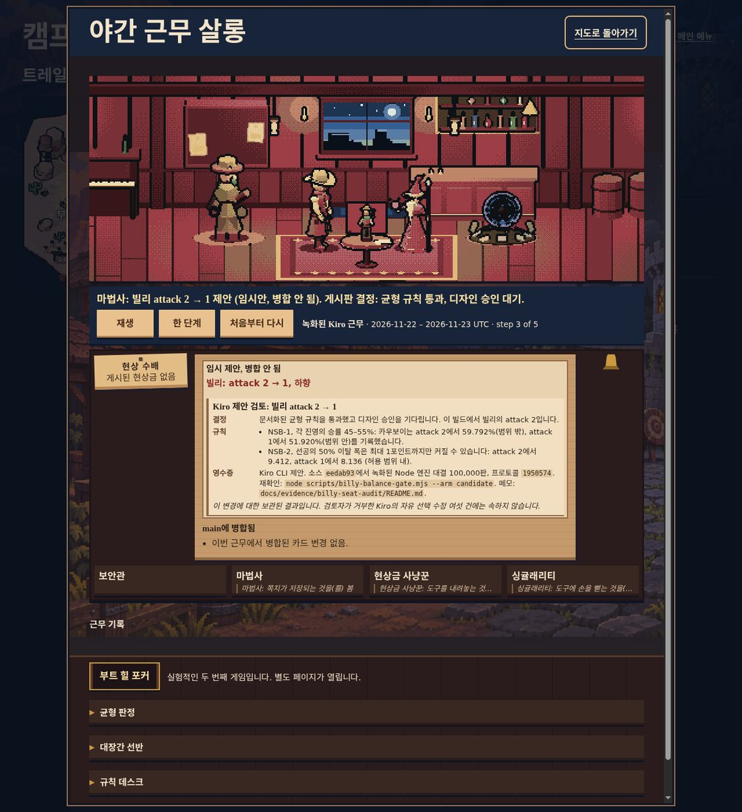

# 🤠 카우보이 vs. 마법사 (Cowboys vs. Wizards) 한글판

> 서부의 카우보이와 마법사가 맞붙는 2인 카드 대결 게임 **Cowboys vs. Wizards**의 비공식 한글화 포크입니다.
> 원작: [alejandro-publius/cowboys-vs-wizards](https://github.com/alejandro-publius/cowboys-vs-wizards) (MIT 라이선스)

## 🎮 플레이

👉 **https://sigco3111.github.io/cowboys-vs-wizards/**

브라우저에서 바로 실행되는 정적 웹 게임입니다. 설치가 필요 없습니다.

## 📖 게임 소개

- 카우보이 vs 마법사 두 진영이 **기지(Base)** 의 오브를 먼저 모두 깎는 쪽이 승리합니다.
- 턴마다 **부대 · 주문 · 장비 · 장소 · 함정** 카드를 내고, 부대로 공격하거나 **엄폐**합니다.
- 캠프에서 덱을 짜고, 대결에서 이기면 새 카드와 팩을 얻어 컬렉션을 키웁니다.
- 화면 구성: 타이틀 · 캠프 · 카드 갤러리 · 쇼다운(3D 보드) · 그레이박스

## 🖼️ 스크린샷 (한글판, 직접 촬영)

| 타이틀 | 쇼다운 대결 |
|---|---|
|  |  |

| 마법사 미리보기 | 야간 근무 살롱 |
|---|---|
|  |  |

## 🌐 한글화 범위

- 화면 UI, 카드 이름과 효과 설명, 대결 진행 기록, 캠프/덱 빌더/갤러리 문구를 한국어로 옮겼습니다.
- 원본의 ID와 구조는 그대로 두었습니다. 규칙 판정에 쓰이는 종족 태그(Lawman, Outlaw 등)와 일부 내부 카드 키는 영어를 유지합니다.
- 한글 표시를 위해 Noto Sans KR 웹폰트(Google Fonts)와 시스템 한글 폰트 대체 목록을 추가했습니다.

## ⚠️ 알려진 한계

- 일부 보조 화면(나이트 시프트 쇼케이스, 규칙 데스크, 리플레이/장부 데이터, 포커 실험작 등)은 아직 영어로 남아 있을 수 있습니다.
- 원작의 자동 테스트와 referee 스크립트는 영어 문구를 기준으로 하므로 한글판에서는 그대로 통과하지 않을 수 있습니다.

## 🛠️ 개발

```bash
npm ci
node scripts/stage-pages.mjs   # dist/web 생성
```

배포는 `gh-pages` 브랜치(= `dist/web` 내용)로 GitHub Pages에 올립니다.

## 📎 원작 자료

원작 README는 [README.en.md](README.en.md)에 그대로 보관되어 있습니다.

## 📜 라이선스 · 크레딧

MIT 라이선스. 원작자 **alejandro-publius** 의 저작물을 기반으로 한 한글화입니다.

## 검증 기준 변경 (한글화에 따른 기대값 조정)

한글화로 화면 문구와 카드 이름이 바뀌어, 언어에 의존하는 테스트 기대값만 한글판에 맞췄습니다. 규칙 검사 자체는 그대로 유지합니다.

- 테스트의 영어 문구 기대값(정규식, 라벨, CSV 키워드·효과문)을 한글로 교체했습니다.
- 심판(referee, 동결된 Python)은 원본 영문 카드 이름으로 판정하므로 `scripts/referee/catalog-names.json`에 영문 이름을 보관하고, 심판 관련 테스트는 원래 영문 기대값을 그대로 씁니다.
- 카드 명세(`.kiro/specs/duel-card-pipeline/cards/*.json`)의 `showdown.name`에 한글 이름을 두고 생성기가 이를 허용합니다. 레인 카드 이름은 영문 그대로입니다.
- 규칙 데스크 인덱스는 `scripts/rules-desk.ko.json` 오버레이를 합쳐 생성하며 `--check`가 통과합니다. 영문 규칙서 인용문은 원문 그대로 둡니다.
- 엔진 동일성 검사(야간 감시 영수증)는 `card-specs.generated.js`, `showdown/cards.js`가 과거 커밋과 바이트가 다르다고 표시합니다. 두 파일(및 `rules.js`)의 코드 골격은 원본과 동일하고 문자열·주석만 다릅니다.
- 포커(`/poker/`)는 엔진(`engine.js`, 증명·테스트가 의존)을 영문으로 두고, 표시 계층 `ko.js`가 엔진 문구를 한글로 바꿔 보여 줍니다. 전각 폭을 고려해 상자 테두리를 맞췄습니다.
- 원본에서도 실패하는 테스트: `tests/experiments/trap-placeholder-scenarios.test.js`("no command for ride-out"). 한글화와 무관합니다.
